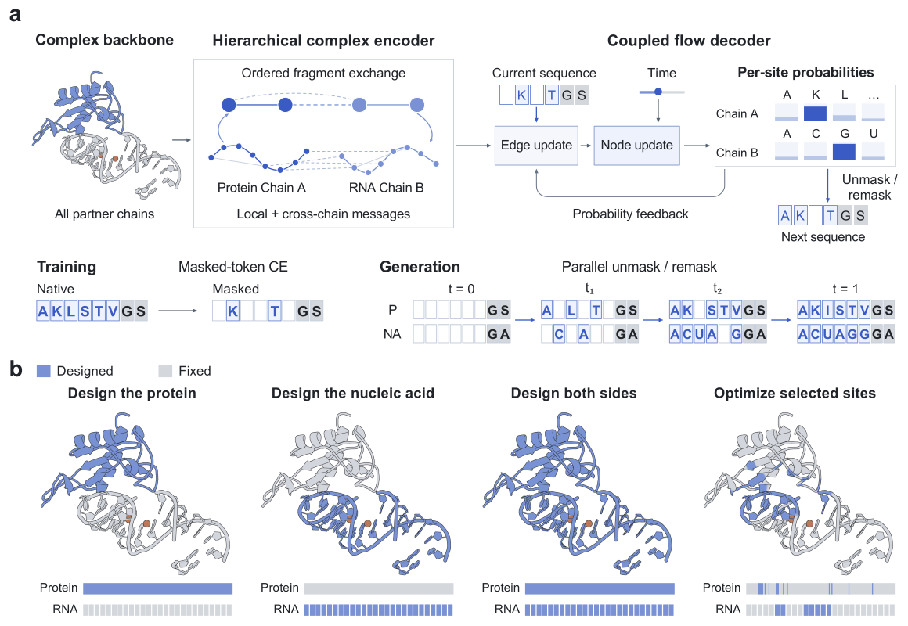

<div align="center">

# ComplexMPNN

**Scalable and universal biomolecular inverse folding**

Design protein, RNA and DNA sequences from a target structure.

[](https://openraiser.github.io/ComplexMPNN/)
[](https://www.modelscope.cn/datasets/yijiezhang/FineBio-Inv)




</div>

ComplexMPNN is a unified inverse-folding model for proteins, RNA and DNA. It
can design individual chains or multiple components together and complete
partially specified sequences. The model uses the complex structure, sequences
at fixed positions, and nearby ligand atoms and metal ions to guide sequence
design.

## Installation

Clone the repository and create an environment. The commands below install
PyTorch with CUDA 12.1 support.

```bash
git clone https://github.com/OpenRaiser/ComplexMPNN.git
cd ComplexMPNN

conda create -n ComplexMPNN python=3.10 pip -y
conda activate ComplexMPNN

pip install --index-url https://download.pytorch.org/whl/cu121 torch==2.5.1
pip install -r requirements.txt
```

The main dependencies are PyTorch, NumPy and Biopython. Message aggregation
uses native PyTorch operations.

## Quick start

The example structure, `examples/1jid.pdb`, contains human SRP19 bound to helix 6
of SRP RNA and two magnesium ions. This command redesigns the protein while
keeping the RNA sequence fixed:

```bash
python complexmpnn/design.py \
  --input examples/1jid.pdb \
  --out_dir out/design \
  --ckpt weights/complexmpnn.pt \
  --design_types protein \
  --temperature 0.1 --flow-steps 50 --num_samples 1 --seed 111
```

`--input` accepts a structure file or a directory of structures in PDB or mmCIF
format, including gzip-compressed files.

## Selecting positions to design

Use `--design_types` to select protein, RNA or DNA chains, or `--design_chains`
to select chains by ID. A design-mask file selects individual positions within
those chains. Positions outside the selection retain their input sequences
and provide context for the design.

For `examples/1jid.pdb`, replace `--design_types protein` in the command above
with one of the following selections:

| Task | Flags |
| --- | --- |
| Design the protein with the RNA fixed | `--design_types protein` |
| Design the RNA with the protein fixed | `--design_types rna` |
| Design the protein and RNA together | `--design_types protein,rna` |
| Design chain A | `--design_chains A` |
| Design selected positions across both chains | `--design_mask examples/design_mask.tsv` |

Multiple types or chain IDs can be separated by commas. For example,
`--design_types rna,dna` designs both nucleic-acid types in a complex. With no
chain, type or position selection, all polymer chains are designed.

`--design_mask` reads a TSV file with three columns: input filename prefix,
chain ID and positions. Positions are numbered from 1 along the parsed chain
and can be listed individually or as ranges, such as `12,15,18-24`. The example
file [`examples/design_mask.tsv`](examples/design_mask.tsv) selects positions
in chains A and B.

### Ligands and metal ions

Ligand atoms and metal ions are read automatically from the input structure.
Their coordinates and element identities provide chemical context and remain
fixed during sequence generation. The run log reports the number of retained
cofactor atoms for each input.

### Sampling

`--num_samples` sets the number of samples generated for each input structure.
Each sample contains a sequence for every designed chain.

`--temperature` controls how strongly sampling favors high-probability amino
acids or nucleotides. The default is 0.1; setting it to 0 selects the
highest-probability identity at each sampling step. `--flow-steps` sets the
number of flow steps. The examples use 50 steps, as in the main manuscript
benchmarks. `--seed` sets the random seed.

### Amino-acid constraints

| Flag | Effect |
| --- | --- |
| `--omit_AA C` | Exclude cysteine from the designed positions |
| `--bias_AA "C:-2.0,W:-0.5"` | Add the specified biases to cysteine and tryptophan logits |
| `--surface_bias -1.0` | Reduce the logits for F, I, L, M, V, W and Y at exposed positions |

These options apply to protein design. Negative biases discourage an amino
acid, and positive biases favor it. Biases are added to the logits before
temperature scaling, so their effect is stronger at lower temperatures.

For `--surface_bias`, a position is treated as exposed when fewer than 14 other
residues have representative atoms within 10 Å of its own representative atom.

## Outputs

| File | Contents |
| --- | --- |
| `designed_sequences.fasta` | One sequence record per designed chain per sample |
| `summary.tsv` | Designed and input sequences, scores and recovery for each chain and sample |
| `metrics.json` | Run settings, input counts and recovery summaries |

## Evaluating sequence recovery

Use `evaluate.py` to generate sequences and calculate recovery on a JSONL
dataset. This example designs the protein chains in each entry:

```bash
python complexmpnn/evaluate.py \
  --ckpt weights/complexmpnn.pt \
  --jsonl data/test.jsonl \
  --task all --design-types protein \
  --num-samples 1 --flow-steps 50 --temperature 0.1 --seed 111 \
  --out out/eval/recovery.tsv
```

`--task` specifies the design task for each entry. `all` selects all polymer
chains, `nucleic_given_protein` designs nucleic acids with the protein fixed,
`protein_given_nucleic` designs proteins with the nucleic acids fixed, and
`one_chain` selects one chain. `--design-types` further restricts the selected
chains to the specified polymer types.

### Recovery summaries

Sequence recovery is the fraction of scored design positions that match the
input sequence. The evaluation script reports averages by chain, entry and
position:

| Summary | Calculation |
| --- | --- |
| `per chain` | Calculate recovery for each chain, then average over chains and samples |
| `per entry` | Calculate recovery across the scored positions in each input structure, then average over entries and samples |
| `pooled` | Divide the total number of matching positions by the total number of scored positions across all samples |

The length-grouped summary uses `recovery` for the mean chain recovery within
each sample, averaged across samples. With the output path above, recovery for
each entry and sample is saved to `out/eval/recovery.tsv`, with separate columns
for protein, RNA and DNA. Length-grouped results are saved to
`out/eval/recovery_by_length.tsv`.

## Data and checkpoints

The released checkpoint is included at
[`weights/complexmpnn.pt`](weights/complexmpnn.pt). It supports protein, RNA and
DNA design with ligand and metal-ion context. Model settings are loaded from
the checkpoint and recorded in the run log.

Specify the checkpoint with `--ckpt`. For `design.py`, the
`COMPLEXMPNN_CKPT` environment variable can also provide the default path.

The [FineBio-Inv dataset](https://www.modelscope.cn/datasets/yijiezhang/FineBio-Inv)
is available on ModelScope.

## Repository layout

```text
complexmpnn/   Sequence design, evaluation and shared input/output utilities
src/          Model architecture, geometric features and tokenization
inference/    Structure parsing
weights/      Released checkpoint
examples/     Example structure and design mask
docs/         Project website
```
